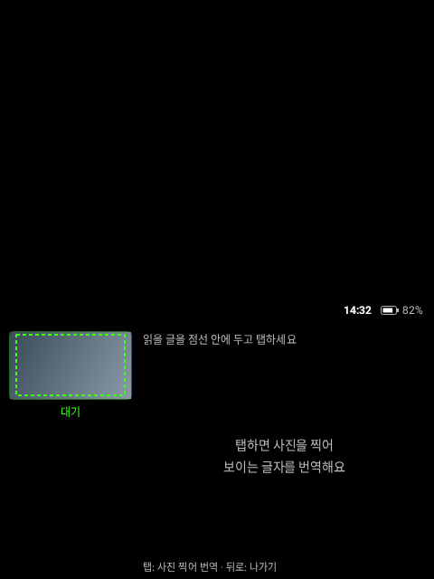
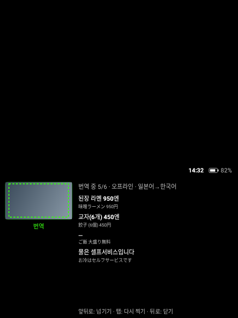

# Rokid Lens

Rokid 안경 카메라로 보이는 글자를 읽어서 바로 번역해 주는 앱입니다. 화면 전체가 아래쪽 **480dp × 282dp 띠** 안에 그려지고, 띠 위쪽은 검은색이라 안경에서는 투명하게 보입니다. rokid-youtube, rokid-conversate와 같은 방식입니다.

[Rokid Nexus](https://github.com/Anezium/Rokid-Nexus)의 **Lens** 플러그인을 바탕으로 했습니다. 원래 Lens는 안경 카메라 영상을 폰으로 보내 폰에서 글자를 읽고 번역합니다. 이 앱은 **폰 없이 안경 혼자** 합니다(iPhone 사용자도 쓸 수 있게). 사진을 탭할 때 한 장 찍어서, 서버의 **Gemini**로 읽고 번역합니다. 인터넷이 없으면 Lens와 같은 **Google ML Kit**으로 안경 안에서 읽습니다.

## 화면

| 대기 | 결과 | 번역 중 |
|---|---|---|
|  |  |  |

위 그림은 [Paparazzi](https://github.com/cashapp/paparazzi)가 실제 레이아웃 코드로 그린 480×640 화면입니다. 왼쪽 카메라 미리보기는 그림 대신 색만 넣었습니다.

## 쓰는 법

| 동작 | 대기 | 결과 |
|---|---|---|
| 탭 | 사진 찍어 번역 | 다시 찍기 |
| 앞/뒤로 쓸기 | — | 다음/이전 문단 |
| 뒤로 | 앱 나가기 | 결과 닫기 |

- **사진으로 읽기:** 글자를 가운데에 두고 탭하면 사진 한 장을 찍어 그 안의 문단을 모두 번역합니다. 번역되는 대로 하나씩 채워지고, 네 문단씩 넘겨 봅니다. 영상을 계속 읽지 않아서 발열이 적습니다.
- **점선 안만 읽기:** 미리보기의 점선 네모(가운데의 가로로 넓은 띠: 폭 90%, 16:9) 안 글자만 번역합니다. 브라우저·앱 화면이나 간판이 많은 곳에서 읽을 부분만 고르려고, 고개를 돌려 점선 안에 넣으면 됩니다. AI 번역은 메뉴·탭·주소창·버튼·광고 같은 화면 장식도 빼고 본문만 번역하며, 가운데에 가장 가까운 문단을 맨 앞에 둡니다(오프라인도 같은 순서).
- **미리보기:** 왼쪽 작은 화면은 조준용입니다. 카메라는 미리보기만 낮은 속도(초당 10장 이상 중 가장 느리게)로 돌리고, 읽는 건 탭할 때 찍은 사진뿐입니다.
- **가운데 2배 확대:** 안경 카메라는 광각이라 가장자리 글자는 작고 휘어서 잘 안 읽힙니다. 카메라 자체 줌으로 가운데만 2배 확대합니다(미리보기와 사진 모두). CPU를 쓰지 않습니다.
- **언어:** 사진을 라틴 문자(영어 등), 일본어, 중국어, 한국어, 데바나가리 순서로 읽어 보고 가장 잘 읽힌 걸 씁니다(Lens의 자동 선택 그대로, 지난번에 잘 읽힌 문자부터). 원문 언어를 알아내서 **한국어로**, 원문이 한국어면 **영어로** 번역합니다.
- **AI 번역 (기본):** 사진을 rokid-conversate 서버(`server-v2`의 `/lens/translate`)로 보내 **Gemini**가 글자를 읽고 번역합니다. ML Kit보다 훨씬 정확하고 자연스럽습니다. 머리줄에 `AI`라고 나옵니다. 서버가 잠들어 있으면 첫 사진은 조금 걸립니다(최대 25초).
- **오프라인 예비:** 인터넷이 없거나 서버·한도 문제로 AI가 실패하면 안경 안의 ML Kit으로 읽습니다(머리줄 `오프라인`). 번역 모델은 언어 쌍마다 처음 한 번 받습니다(약 30MB). 그다음엔 인터넷 없이 됩니다.
- **소리 없음:** 셔터음을 포함해 아무 소리도 내지 않습니다.
- **R08 링:** rokid-youtube와 같습니다(링 앞/뒤 = 쓸기, 탭 = 탭).
- **배터리:** 앱이 화면 뒤로 가면 카메라를 끕니다. 앱이 켜져 있는 동안은 화면이 꺼지지 않습니다.
- **상태 표시, Wi-Fi 자동 켜기, 자동 업데이트:** rokid-youtube와 같습니다(띠 위 시각·배터리, rokid-conversate의 'Wi-Fi 켜기 도우미', 앱을 켤 때 server-v2에서 업데이트 확인, 설치 허용이 없으면 허용 화면을 한 번 띄움).

## Rokid Nexus Lens에서 가져온 것

| 이 프로젝트 | Rokid Nexus `plugins/lens` |
|---|---|
| `lens/AutoScriptPolicy.kt` | `AutoScriptPolicy.kt` (그대로, 테스트 포함) |
| `lens/ParagraphSegmentation.kt` | `ParagraphSegmentation.kt` (그대로) |
| `lens/LensTranslator.kt` | `MlKitTranslationProvider.kt`를 코루틴으로 간단히 다시 씀 |
| `lens/LensPipeline.kt`, `camera/LensCamera.kt` | 새로 씀 (원래는 폰의 OCR 파이프라인 + 안경 허브의 카메라 스트리밍. 실시간 영상 인식 대신 탭할 때 사진 한 장) |

Nexus 버스, Wi-Fi Direct, 폰 핫스팟 연결은 필요 없어서 가져오지 않았습니다.

## 빌드와 설치

```bash
./gradlew :app:assembleDebug
adb install -r app/build/outputs/apk/debug/app-debug.apk
```

릴리스(고정 키로 서명, OTA 서버에 올리기):

```bash
RELEASE_KEYSTORE=... RELEASE_KEYSTORE_PASS=... OTA_UPLOAD_TOKEN=... scripts/release.sh 0.1.0 --upload
```

처음 한 번은 케이블로 설치합니다. 그다음부터는 앱을 켤 때 알아서 업데이트됩니다.

```bash
adb install -r -i com.chorockkim.rokidlens rokid-lens-0.1.0.apk
adb shell appops set com.chorockkim.rokidlens REQUEST_INSTALL_PACKAGES allow
adb shell appops set com.chorockkim.rokidlens SYSTEM_ALERT_WINDOW allow
```

OTA 서버(rokid-conversate server-v2)의 `OTA_PUBLIC_APPS`에 `rokid-lens`가 있어야 합니다.

## 테스트

```bash
./gradlew :app:testDebugUnitTest      # Lens 로직(문자 자동 선택), 문단, 언어 정하기, 카메라 속도, 입력, OTA
./gradlew :app:recordPaparazziDebug   # 화면 스냅샷 → app/src/test/snapshots/images
```

## 확인한 것과 안 한 것

- **확인함:** 빌드, 단위 테스트, 화면 스냅샷.
- **안경에서 확인해야 함:** 카메라 줌과 낮은 프레임 속도가 먹히는지, 사진 한 장 읽는 시간, ML Kit 번역 모델 받기(Google Play 서비스 없는 기기에서), 실제 번역 품질, 배터리.

## 라이선스

Apache License 2.0. Rokid Nexus(Apache 2.0)의 코드를 포함합니다. [NOTICE](NOTICE)를 보세요.
