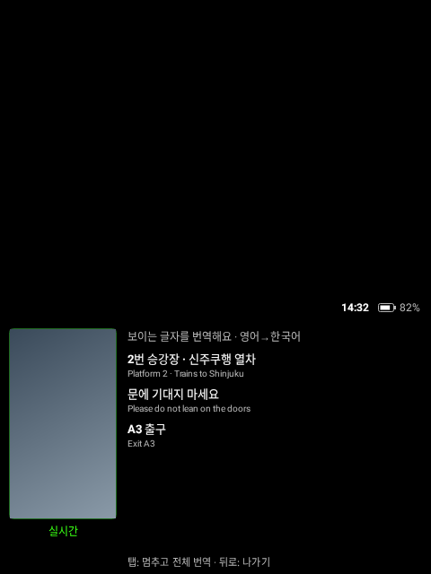
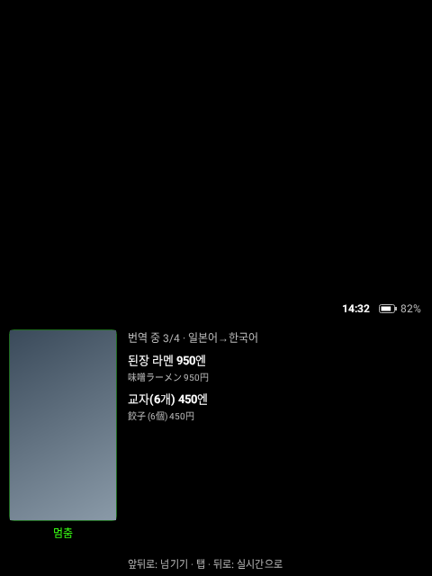
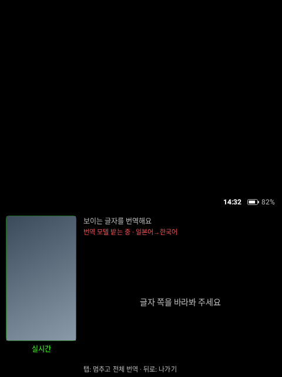

# Rokid Lens

Rokid 안경 카메라로 보이는 글자를 읽어서 바로 번역해 주는 앱입니다. 화면 전체가 아래쪽 **480dp × 282dp 띠** 안에 그려지고, 띠 위쪽은 검은색이라 안경에서는 투명하게 보입니다. rokid-youtube, rokid-conversate와 같은 방식입니다.

[Rokid Nexus](https://github.com/Anezium/Rokid-Nexus)의 **Lens** 플러그인을 바탕으로 했습니다. 원래 Lens는 안경 카메라 영상을 폰으로 보내 폰에서 글자를 읽고 번역합니다. 이 앱은 **폰 없이 안경 혼자** 합니다(iPhone 사용자도 쓸 수 있게). 글자 인식과 번역은 Lens와 같은 **Google ML Kit**이고, 안경 안에서 돌아서 인터넷 없이도 됩니다(번역 모델만 처음 한 번 받음).

## 화면

| 실시간 | 멈춤 (전체 번역) | 글자 찾는 중 |
|---|---|---|
|  |  |  |

위 그림은 [Paparazzi](https://github.com/cashapp/paparazzi)가 실제 레이아웃 코드로 그린 480×640 화면입니다. 왼쪽 카메라 미리보기는 그림 대신 색만 넣었습니다.

## 쓰는 법

| 동작 | 실시간 | 멈춤 |
|---|---|---|
| 탭 | 멈추고 고해상도 사진으로 전체 번역 | 실시간으로 |
| 앞/뒤로 쓸기 | — | 다음/이전 문단 |
| 뒤로 | 앱 나가기 | 실시간으로 |

- **실시간:** 0.8초에 한 번 카메라 영상을 읽어, 화면 가운데에 가깝고 큰 글자 최대 3문단을 번역해 보여 줍니다(위에서 아래 순서). 움직이는 중 한두 장 글자가 안 보여도 바로 지우지 않습니다.
- **멈춤:** 사진 한 장을 찍어 그 안의 모든 문단을 번역합니다. 번역되는 대로 하나씩 채워지고, 두 문단씩 넘겨 봅니다. 메뉴판, 안내문처럼 글이 많은 곳에 씁니다.
- **언어:** 라틴 문자(영어 등), 일본어, 중국어, 한국어, 데바나가리 글자를 읽습니다. 평소엔 라틴 문자로 읽다가 3초마다 다른 문자로도 읽어 보고, 더 잘 읽히면 바꿉니다(Lens의 자동 선택 그대로). 원문 언어를 알아내서 **한국어로**, 원문이 한국어면 **영어로** 번역합니다.
- **번역 모델:** 언어 쌍마다 처음 한 번 받습니다(약 30MB, "번역 모델 받는 중" 표시). 그다음엔 인터넷 없이 됩니다.
- **R08 링:** rokid-youtube와 같습니다(링 앞/뒤 = 쓸기, 탭 = 탭).
- **배터리:** 카메라와 글자 인식이 가장 많이 씁니다. 앱이 화면 뒤로 가면 카메라를 끕니다. 앱이 켜져 있는 동안은 화면이 꺼지지 않습니다.
- **앞사람에게 덜 보이게:** 카메라 미리보기는 작고 조금 어둡게 그립니다.
- **상태 표시, Wi-Fi 자동 켜기, 자동 업데이트:** rokid-youtube와 같습니다(띠 위 시각·배터리, rokid-conversate의 'Wi-Fi 켜기 도우미', 앱을 켤 때 server-v2에서 업데이트 확인).

## Rokid Nexus Lens에서 가져온 것

| 이 프로젝트 | Rokid Nexus `plugins/lens` |
|---|---|
| `lens/OcrCadencePolicy.kt` | `OcrCadencePolicy.kt` (그대로, 테스트 포함) |
| `lens/AutoScriptPolicy.kt` | `AutoScriptPolicy.kt` (그대로, 테스트 포함) |
| `lens/ParagraphSegmentation.kt` | `ParagraphSegmentation.kt` (그대로) |
| `lens/LensTranslator.kt` | `MlKitTranslationProvider.kt`를 코루틴으로 간단히 다시 씀 |
| `lens/LensPipeline.kt`, `camera/LensCamera.kt` | 새로 씀 (원래는 폰의 `LiveOcrPipeline` + 안경 허브의 카메라 스트리밍) |

Nexus 버스, Wi-Fi Direct, 폰 핫스팟 연결은 필요 없어서 가져오지 않았습니다.

## 빌드와 설치

```bash
./gradlew :app:assembleDebug
adb install -r app/build/outputs/apk/debug/app-debug.apk
```

릴리스(고정 키로 서명, OTA 서버에 올리기):

```bash
RELEASE_KEYSTORE=... RELEASE_KEYSTORE_PASS=... OTA_UPLOAD_TOKEN=... scripts/release.sh 0.1.0 --upload
```

처음 한 번은 케이블로 설치합니다. 그다음부터는 앱을 켤 때 알아서 업데이트됩니다.

```bash
adb install -r -i com.chorockkim.rokidlens rokid-lens-0.1.0.apk
adb shell appops set com.chorockkim.rokidlens REQUEST_INSTALL_PACKAGES allow
adb shell appops set com.chorockkim.rokidlens SYSTEM_ALERT_WINDOW allow
```

OTA 서버(rokid-conversate server-v2)의 `OTA_PUBLIC_APPS`에 `rokid-lens`가 있어야 합니다.

## 테스트

```bash
./gradlew :app:testDebugUnitTest      # Lens 로직(문자 자동 선택, 빈도), 문단 고르기, 언어 정하기, 입력, OTA
./gradlew :app:recordPaparazziDebug   # 화면 스냅샷 → app/src/test/snapshots/images
```

## 확인한 것과 안 한 것

- **확인함:** 빌드, 단위 테스트, 화면 스냅샷.
- **안경에서 확인해야 함:** 카메라가 열리는지(CameraX, Nexus 기준 카메라 id `0`), 안경 칩에서 실시간 글자 인식 속도, ML Kit 번역 모델 받기(Google Play 서비스 없는 기기에서), 실제 번역 품질, 배터리.

## 라이선스

Apache License 2.0. Rokid Nexus(Apache 2.0)의 코드를 포함합니다. [NOTICE](NOTICE)를 보세요.
